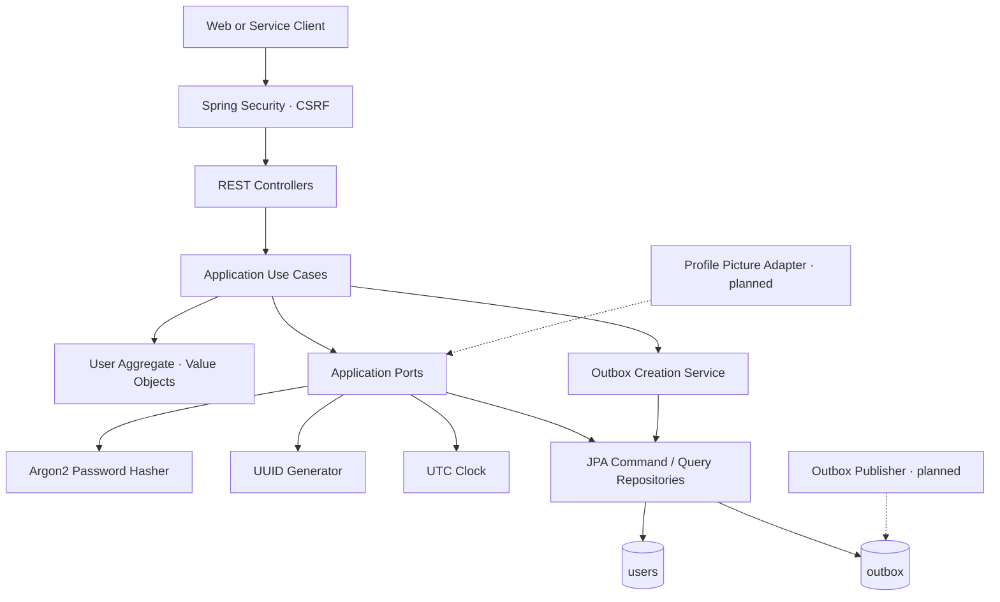
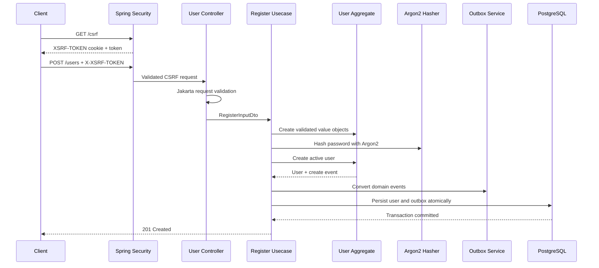
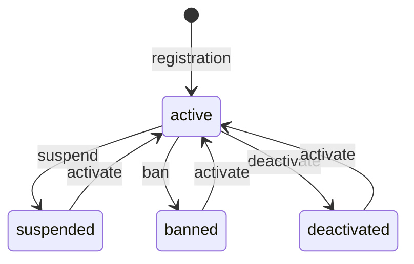
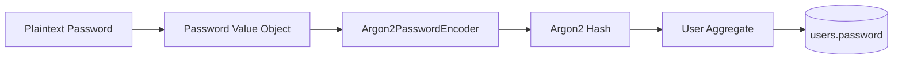
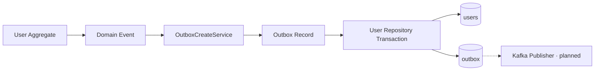

<div align="center">

# WERANT USER SERVICE

### User Identity and Lifecycle Service

**Register. Protect. Evolve.**

A domain-oriented user service for the Werant ecosystem.

Built with Java 21, Spring Boot, PostgreSQL, Flyway, Spring Security, Argon2, and a transactional outbox.

<br />

[](https://openjdk.org/)
[](https://spring.io/projects/spring-boot)
[](https://www.postgresql.org/)
[](https://maven.apache.org/)

<br />


</div>

---

## Overview

**Werant User Service** owns user registration, profile identity, account lifecycle state, password protection,
verification flags, and user-domain events for the Werant platform.

The service originated in the Foundation codebase and now belongs to the Werant ecosystem alongside Werant Rotation Key
and Image Processing Worker. The existing `dev.foundation` Java namespace is retained for compatibility while product
scope, documentation, and future evolution follow the Werant platform.

The service models users independently from HTTP, JPA, PostgreSQL, and cryptographic libraries. Application use cases
depend on ports, infrastructure adapters implement those contracts, and the presentation layer assembles the runtime
through Spring configuration.

Registration persists the user and its domain event in the same PostgreSQL transaction. The event is stored in an outbox
record with a JSON payload so that asynchronous delivery can be implemented without losing the atomic relationship
between state change and event creation.

The design is guided by six principles:

- **Domain-owned validation** — Core identity values are represented by validated value objects.
- **Password confidentiality** — Plaintext passwords are validated and immediately transformed into Argon2 hashes before
  persistence.
- **Atomic event creation** — User state and outbox records are persisted inside the same transaction.
- **Explicit account lifecycle** — User status is represented by `active`, `deactivated`, `suspended`, and `banned`
  states.
- **Dependency isolation** — Use cases depend on ports for persistence, identifiers, time, hashing, and future
  object-storage access.
- **Secure browser boundary** — CSRF protection is enabled for the planned JWT-in-HttpOnly-cookie authentication flow.

> [!NOTE]
> The project is under active development. Registration, domain validation, Argon2 password hashing, PostgreSQL
persistence, Flyway migrations, transactional outbox creation, CSRF token delivery, exception normalization, and
automated domain/application tests are implemented. Cookie-based JWT authentication, event publication, profile-picture
storage, e-mail queries, verification workflows, audit trails, and operational controls remain roadmap work.

---

## Architecture

The service combines Domain-Driven Design, Event-Driven Architecture, CQRS, Clean Architecture, and Hexagonal
Architecture. Ports and adapters keep domain behavior independent from delivery and persistence concerns, while command
and query responsibilities evolve separately.



### Architectural Layers

| Layer              | Responsibility                                                                                                             |
|:-------------------|:---------------------------------------------------------------------------------------------------------------------------|
| **Domain**         | Represents users, account states, value objects, domain events, and aggregate behavior without Spring or JPA dependencies. |
| **Application**    | Defines use cases, infrastructure ports, DTOs, and application services such as outbox creation.                           |
| **Infrastructure** | Implements PostgreSQL repositories, persistence entities, mappers, Argon2 hashing, UUID generation, and the system clock.  |
| **Presentation**   | Exposes HTTP endpoints, request validation, exception mapping, security configuration, and dependency assembly.            |

The application layer does not construct `EntityManager`, password encoders, or Spring-managed infrastructure directly.
Concrete adapters are created in configuration classes and injected through application ports.

### Framework Isolation

Spring is deliberately postponed to the presentation and composition boundary. Controllers, security filters,
exception advice, profiles, and dependency assembly live under `presentation`, keeping the domain and application layers
free from Spring annotations and runtime types.

Infrastructure contains only adapter-specific technology dependencies: JPA/Hibernate for PostgreSQL persistence and
Spring Security Crypto inside the Argon2 password-hashing adapter. These dependencies implement application ports and do
not leak into use cases or domain entities.

This separation serves each architectural style explicitly:

| Style | Application in this service |
|:------|:----------------------------|
| **DDD** | The `User` aggregate, value objects, lifecycle states, and domain events own business behavior. |
| **EDA** | Aggregate changes produce durable events through the transactional outbox. |
| **CQRS** | Command and query repository ports are separated and can evolve independently. |
| **Clean Architecture** | Dependencies point inward toward application contracts and domain rules. |
| **Hexagonal Architecture** | Ports describe required capabilities; adapters connect PostgreSQL, hashing, time, identifiers, HTTP, and future object storage. |

### Registration Flow



### Transaction Boundary

Registration produces two persistence effects:

1. Insert the new record in `users`.
2. Insert the corresponding `create` event in `outbox`.

Both operations run through the command repository transaction. If either insert or the final flush fails, the
transaction is rolled back.

This boundary ensures that a committed user is accompanied by a durable event record and that an event is not committed
for a user that failed to persist.

---

## User Domain

### User Aggregate

The `User` aggregate contains:

| Field              | Domain representation | Purpose                                                                    |
|:-------------------|:----------------------|:---------------------------------------------------------------------------|
| `id`               | `UUID`                | Stable internal identity.                                                  |
| `name`             | `Name`                | Validated display name.                                                    |
| `username`         | `Username`            | Profile-facing username. It is not a login identifier.                     |
| `email`            | `Email`               | Validated e-mail address with database uniqueness.                         |
| `phoneNumber`      | `PhoneNumber`         | Optional profile and verification attribute. It is not a login identifier. |
| `password`         | `HashedPassword`      | Persisted Argon2 password hash.                                            |
| `status`           | `UserStatus`          | Current lifecycle state.                                                   |
| `profilePictureId` | `UUID`                | Optional reference reserved for profile-picture support.                   |
| `emailVerified`    | `boolean`             | E-mail verification state.                                                 |
| `numberVerified`   | `boolean`             | Phone-number verification state.                                           |
| `createdAt`        | `Date`                | UTC creation time.                                                         |
| `updatedAt`        | `Date`                | UTC last-update time.                                                      |

Username and phone number intentionally do not define authentication identity and therefore are not modeled as login
keys.

### Account Lifecycle

Every user has one of four domain states.



| Status        | Meaning                                                                              |
|:--------------|:-------------------------------------------------------------------------------------|
| `active`      | Account is enabled for normal platform use. New users currently start in this state. |
| `deactivated` | Account has been deliberately disabled.                                              |
| `suspended`   | Account access has been temporarily restricted.                                      |
| `banned`      | Account access has been administratively blocked.                                    |

Lifecycle methods return a new immutable `User` instance and attach the corresponding domain event.

### Domain Events

The aggregate currently defines the following event types:

| Event                 | Trigger                            |
|:----------------------|:-----------------------------------|
| `create`              | A new user is registered.          |
| `change_username`     | The profile username changes.      |
| `change_password`     | The password hash changes.         |
| `change_email`        | The e-mail address changes.        |
| `change_phone_number` | The optional phone number changes. |
| `change_role`         | A user role changes.               |
| `activate`            | An account becomes active.         |
| `deactivate`          | An account becomes inactive.       |
| `suspend`             | An account is suspended.           |
| `ban`                 | An account is banned.              |

Not every event already has an exposed HTTP use case. The event model defines the domain vocabulary that future
application workflows will use.

---

## Validation and Password Protection

Validation occurs at two boundaries:

1. Jakarta Bean Validation rejects malformed HTTP requests before use-case execution.
2. Domain value objects enforce the same business invariants independently from HTTP.

### Registration Input

| Field         | Rules                                                                                                         |
|:--------------|:--------------------------------------------------------------------------------------------------------------|
| `name`        | Required, at most 100 characters, letters and single spaces.                                                  |
| `username`    | Required, at most 50 characters, letters and single spaces.                                                   |
| `email`       | Required, valid e-mail format, at most 150 characters.                                                        |
| `phoneNumber` | Optional; when present, must match the supported Brazilian mobile format.                                     |
| `password`    | Required, 8–128 characters, with lowercase, uppercase, and numeric characters using the supported symbol set. |

Unexpected JSON properties are rejected through Jackson configuration.

### Password Lifecycle



The plaintext password is not stored in the domain aggregate or database. The `PasswordHasherPort` isolates application
behavior from Spring Security's concrete Argon2 encoder.

---

## Transactional Outbox

Every domain event converted by `OutboxCreateService` receives delivery metadata and is persisted in the `outbox` table.



### Outbox State

| Field                   | Purpose                                                               |
|:------------------------|:----------------------------------------------------------------------|
| `id`                    | Domain event identifier.                                              |
| `aggregate_id`          | User aggregate identifier.                                            |
| `aggregate_type`        | Aggregate category, currently `user`.                                 |
| `event_type`            | Event name such as `create`.                                          |
| `reason`                | Optional lifecycle-transition reason.                                 |
| `payload`               | JSONB envelope containing event metadata.                             |
| `occurred_at`           | Time at which the domain event occurred.                              |
| `retry_limit`           | Maximum intended publication attempts, default `5`.                   |
| `retry_count`           | Current publication attempts, initially `0`.                          |
| `status`                | Publication state: `pending`, `processing`, `published`, or `failed`. |
| `processing_started_at` | Optional processing start time.                                       |
| `last_attempt_at`       | Optional last-attempt time.                                           |
| `next_attempt_at`       | Optional scheduled retry time.                                        |
| `published_at`          | Optional successful-publication time.                                 |
| `created_at`            | Record creation time.                                                 |
| `updated_at`            | Last record-update time.                                              |

Example payload:

```json
{
  "eventId": "018f0000-0000-7000-8000-000000000001",
  "aggregateId": "018f0000-0000-7000-8000-000000000002",
  "eventType": "create",
  "aggregateType": "user",
  "reason": null,
  "occurredAt": "2026-12-01T00:00:00Z"
}
```

Publication and retry processing are intentionally outside the current implementation. The schema and domain model
already reserve the state required by the future relay.

---

## Persistence Model

### `users`

| Column               | PostgreSQL type        | Purpose                             |
|:---------------------|:-----------------------|:------------------------------------|
| `id`                 | `UUID`                 | Primary key.                        |
| `name`               | `VARCHAR(100)`         | User display name.                  |
| `username`           | `VARCHAR(50)`          | Profile username.                   |
| `password`           | `VARCHAR(255)`         | Argon2 password hash.               |
| `email`              | `VARCHAR(255)`         | Unique e-mail address.              |
| `phone_number`       | Nullable `VARCHAR(50)` | Optional phone number.              |
| `status`             | `VARCHAR(20)`          | Account lifecycle state.            |
| `profile_picture_id` | Nullable `UUID`        | Reserved profile-picture reference. |
| `email_verified`     | `BOOLEAN`              | E-mail verification flag.           |
| `number_verified`    | `BOOLEAN`              | Phone verification flag.            |
| `created_at`         | `TIMESTAMP`            | Creation time.                      |
| `updated_at`         | `TIMESTAMP`            | Last update time.                   |

Flyway applies versioned migrations automatically during application startup once PostgreSQL is available.

### Migration History

| Migration | Change                                                |
|:----------|:------------------------------------------------------|
| `V1`      | Creates the initial `users` table.                    |
| `V3`      | Adds e-mail and phone verification flags.             |
| `V4`      | Makes the profile-picture reference optional.         |
| `V5`      | Creates the transactional `outbox` table and indexes. |
| `V6`      | Makes the phone number optional.                      |
| `V7`      | Adds the non-null JSONB outbox payload.               |

---

## HTTP API

### Endpoint Summary

| Method | Path      | Access        | Purpose                                        |
|:-------|:----------|:--------------|:-----------------------------------------------|
| `GET`  | `/health` | Public        | Lightweight process health response.           |
| `GET`  | `/csrf`   | Public        | Issues the CSRF token and `XSRF-TOKEN` cookie. |
| `POST` | `/users`  | Public + CSRF | Registers a new user.                          |

All other routes require authentication. The JWT cookie authentication filter and token lifecycle are roadmap items and
are not yet installed.

### CSRF Handshake

The service uses `CookieCsrfTokenRepository`.

- `GET /csrf` returns the token and writes the `XSRF-TOKEN` cookie.
- The client sends the token in the `X-XSRF-TOKEN` header for state-changing requests.
- The CSRF cookie is intentionally readable by the browser client.
- The future JWT access-token cookie will be a separate HttpOnly cookie.

Example:

```bash
CSRF_TOKEN=$(curl --silent \
  --cookie-jar cookies.txt \
  http://localhost:8080/csrf | jq --raw-output '.token')

curl --request POST http://localhost:8080/users \
  --cookie cookies.txt \
  --header 'Content-Type: application/json' \
  --header "X-XSRF-TOKEN: ${CSRF_TOKEN}" \
  --data '{
    "name": "Leonardo Silva",
    "username": "Leonardo",
    "email": "leonardo@example.com",
    "phoneNumber": "1191234-5678",
    "password": "StrongPass9!"
  }'
```

### Registration Response

Successful registration returns `201 Created`:

```json
{
  "id": "018f0000-0000-7000-8000-000000000001",
  "email": "leonardo@example.com",
  "status": "active"
}
```

### Error Contract

Application errors use a common response shape:

```json
{
  "message": "Email has an invalid format.",
  "code": 400,
  "locale": "RequestRegisterUserDto",
  "violation": "INVALID ARGUMENT"
}
```

Unexpected server failures return a generic message without exposing exception classes, database details, or stack
traces.

---

## Security Model

| Control              | Strategy                                                                 |
|:---------------------|:-------------------------------------------------------------------------|
| Password storage     | Argon2 through Spring Security Crypto.                                   |
| Request validation   | Jakarta validation at the HTTP boundary and value objects in the domain. |
| CSRF                 | Cookie-backed CSRF token with `X-XSRF-TOKEN` request header.             |
| Session policy       | Stateless Spring Security filter chain.                                  |
| Authentication       | JWT access token in an HttpOnly cookie, planned.                         |
| Public routes        | Explicit allowlist for registration, CSRF bootstrap, and health.         |
| Error disclosure     | Generic 5xx responses and disabled framework error details.              |
| Management endpoints | Only health is exposed; health details are hidden.                       |
| Database access      | Credentials supplied through environment configuration.                  |
| Local PostgreSQL     | Compose binds PostgreSQL only to `127.0.0.1`.                            |
| Event durability     | User and outbox records share a database transaction.                    |

CSRF protection remains enabled specifically because browser authentication will use an HttpOnly cookie. The readable
CSRF cookie contains only the anti-CSRF token; it is not the authentication credential.

---

## Repository Structure

```text
user-service/
│
├── src/
│   ├── main/
│   │   ├── java/dev/foundation/userservice/
│   │   │   ├── application/
│   │   │   │   ├── ports/                    # Infrastructure contracts
│   │   │   │   ├── services/                 # Outbox application service
│   │   │   │   └── usecases/                 # Registration and query workflows
│   │   │   ├── domain/
│   │   │   │   ├── aggregate/                # Aggregate root behavior
│   │   │   │   ├── entities/                 # User and outbox domain entities
│   │   │   │   ├── events/                   # User lifecycle events
│   │   │   │   ├── pattern/                  # Validation patterns
│   │   │   │   └── value_objects/            # Validated domain values
│   │   │   ├── infrastructure/
│   │   │   │   ├── db/
│   │   │   │   │   ├── entities/             # JPA entities
│   │   │   │   │   ├── mappers/              # Domain ↔ persistence conversion
│   │   │   │   │   ├── projections/          # Query projections
│   │   │   │   │   └── repositories/         # Command and query adapters
│   │   │   │   └── packages/                 # Clock, UUID, and hashing adapters
│   │   │   ├── presentation/
│   │   │   │   ├── config/                   # Spring and security assembly
│   │   │   │   ├── controllers/              # REST endpoints
│   │   │   │   └── dtos/                     # HTTP request DTOs
│   │   │   └── UserServiceApplication.java
│   │   └── resources/
│   │       ├── db/migration/                  # Flyway SQL migrations
│   │       └── application.yaml               # Runtime configuration
│   └── test/java/                             # Unit and Testcontainers tests
│
├── .env.example                               # Local environment template
├── compose.yaml                               # Local PostgreSQL
├── mvnw                                       # Maven wrapper
└── pom.xml                                    # Java dependencies and build
```

### Component Responsibilities

| Component                | Responsibility                                                                                                                            |
|:-------------------------|:------------------------------------------------------------------------------------------------------------------------------------------|
| `RegisterUsecase`        | Validates registration input, creates identity and timestamps, hashes the password, creates outbox records, and persists the transaction. |
| `User`                   | Represents user state and produces lifecycle domain events.                                                                               |
| `OutboxCreateService`    | Converts aggregate events into pending outbox records.                                                                                    |
| `UserCommandRepository`  | Persists users and outbox records transactionally.                                                                                        |
| `UserQueryRepository`    | Hosts CQRS-style user projections; current query workflows remain under development.                                                      |
| `PasswordHasher`         | Hashes and verifies passwords with Argon2.                                                                                                |
| `UserMapper`             | Converts between domain users and JPA entities.                                                                                           |
| `OutboxMapper`           | Converts outbox domain records and serializes their JSON payload.                                                                         |
| `GlobalExceptionHandler` | Maps validation, application, and infrastructure failures to the HTTP error contract.                                                     |
| `SecurityConfig`         | Defines CSRF, stateless behavior, public routes, and the protected default.                                                               |

---

## Configuration

Runtime values are supplied through environment variables.

| Variable           |   Required   | Default                 | Purpose                                        |
|:-------------------|:------------:|:------------------------|:-----------------------------------------------|
| `DB_HOST`          |      No      | `localhost`             | PostgreSQL host.                               |
| `DB_PORT`          |      No      | `5432`                  | PostgreSQL port.                               |
| `DB_NAME`          |      No      | `user_service`          | PostgreSQL database.                           |
| `DB_USER`          |     Yes      | —                       | PostgreSQL user.                               |
| `DB_PASSWORD`      |     Yes      | —                       | PostgreSQL password.                           |
| `MINIO_ENABLED`    |      No      | `false`                 | Enables future profile-picture storage wiring. |
| `MINIO_ENDPOINT`   |      No      | `http://localhost:9000` | Future S3-compatible endpoint.                 |
| `MINIO_ACCESS_KEY` | When enabled | —                       | Future object-storage access key.              |
| `MINIO_SECRET_KEY` | When enabled | —                       | Future object-storage secret key.              |
| `MINIO_BUCKET`     |      No      | `user-service`          | Future profile-picture bucket.                 |

Copy the local template:

```bash
cp .env.example .env
```

The `.env` file is local-only and ignored by Git. Spring Boot does not load it automatically, so export it before
starting the application:

```bash
set -a
source .env
set +a
```

---

## Local Development

### Requirements

- JDK 21.
- Docker with Compose support.
- `jq` only if using the CSRF `curl` example exactly as written.

Maven does not need to be installed globally because the repository includes the Maven wrapper.

### Start PostgreSQL

```bash
cp .env.example .env
# Replace the local DB_PASSWORD placeholder in .env.

docker compose up -d
docker compose ps
```

PostgreSQL is available only on the local loopback interface. Flyway applies the schema when the service starts.

### Start the Service

```bash
set -a
source .env
set +a

./mvnw spring-boot:run
```

The default HTTP address is:

```text
http://localhost:8080
```

### Stop Local Infrastructure

```bash
docker compose down
```

To remove the local PostgreSQL volume as well:

```bash
docker compose down --volumes
```

---

## Development

### Compile

```bash
./mvnw compile
```

### Test

```bash
./mvnw test
```

The automated suite covers:

- User aggregate construction, immutability, lifecycle changes, and domain events.
- Name, username, e-mail, password, date, and user-status value objects.
- Registration orchestration and dependency error propagation.
- Outbox creation defaults and event preservation.
- Outbox JSON payload serialization.
- Spring application context with PostgreSQL, Redis, and Kafka Testcontainers.

The Testcontainers context test requires a running Docker daemon.

### Package

```bash
./mvnw package
```

### Run the Packaged Service

```bash
java -jar target/user-service-0.0.1-SNAPSHOT.jar
```

### Design Rules

When extending the service:

- Keep domain entities independent from Spring, JPA, and transport DTOs.
- Define external behavior through application ports.
- Keep password plaintext outside persisted entities and responses.
- Create domain events at the aggregate boundary.
- Persist state changes and their outbox records in one transaction.
- Use Flyway migrations for every schema change.
- Treat username and phone number as profile attributes, not login identifiers.
- Keep profile-picture object keys and presigned URLs behind application ports.
- Preserve the common HTTP exception contract.
- Add tests at the domain, use-case, mapper, and integration boundaries affected by a change.

---

## Development Status

### Implemented

- [x] Define the user aggregate and lifecycle states.
- [x] Implement validated identity value objects.
- [x] Implement user registration.
- [x] Hash passwords with Argon2.
- [x] Persist users through a command repository.
- [x] Create domain events for user lifecycle changes.
- [x] Persist user creation and outbox events transactionally.
- [x] Serialize outbox event metadata as JSONB payloads.
- [x] Version the PostgreSQL schema with Flyway.
- [x] Add request validation and a normalized error contract.
- [x] Add CSRF token delivery for cookie-based browser authentication.
- [x] Add domain, application, mapper, and context tests.
- [x] Provide local PostgreSQL through Docker Compose.

### Roadmap

- [ ] Implement JWT access and refresh tokens using secure HttpOnly cookies.
- [ ] Complete authentication and logout flows while preserving CSRF protection.
- [ ] Implement e-mail and phone verification workflows.
- [ ] Complete user query use cases, including controlled e-mail lookup.
- [ ] Implement profile-picture upload and retrieval through presigned object-storage URLs.
- [ ] Add the outbox relay, Kafka publication, retry scheduling, and delivery monitoring.
- [ ] Add registration and security-event audit trails.
- [ ] Add rate limiting and abuse controls at the appropriate application or gateway boundary.
- [ ] Add structured logs, metrics, tracing, dashboards, and alerts.
- [ ] Add CI validation and release automation.

---

## Engineering Philosophy

Werant User Service is designed around a simple principle:

**Identity behavior should remain explicit at every boundary.**

HTTP validation protects the transport boundary. Value objects protect the domain boundary. Argon2 protects stored
passwords. CSRF protects cookie-authenticated browser actions. Transactions protect the relationship between user state
and domain events. Ports protect the application from infrastructure details.

The objective is not only to register users, but to keep identity changes understandable, testable, and durable as the
surrounding platform grows.

---

## License

This project is licensed under the [MIT License](./LICENSE).

---

<div align="center">

**WERANT / USER SERVICE**

_Identity with explicit boundaries._

<sub>DDD · EDA · CQRS · Clean Architecture · Hexagonal Architecture</sub>

</div>
